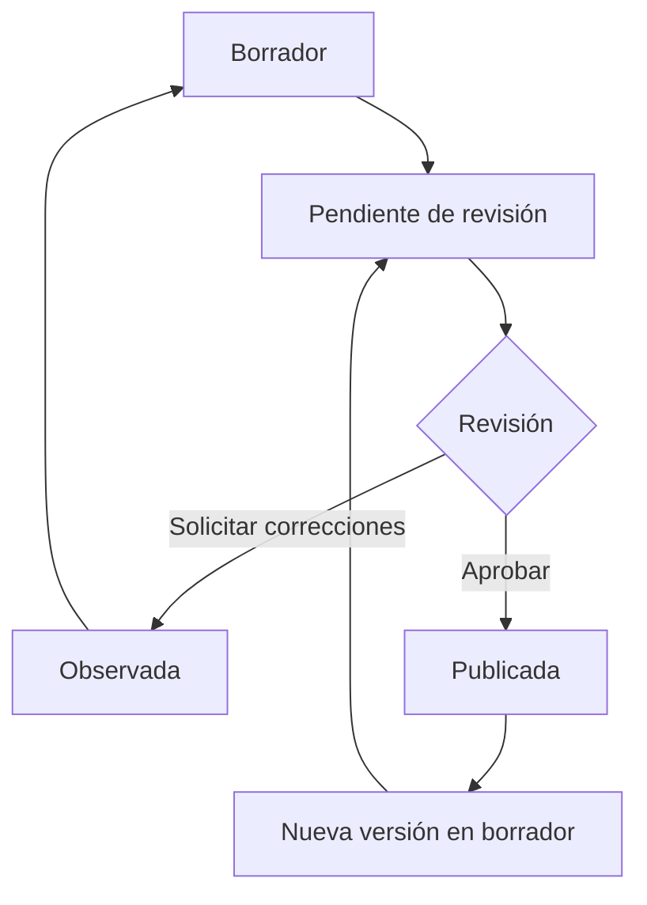

# Portal turístico de Casablanca

Proyecto Integrado desarrollado por estudiantes de Ingeniería
en Informática de INACAP Valparaíso, en colaboración con la
Municipalidad de Casablanca.

## Descripción

Plataforma web destinada a promover los atractivos turísticos,
el patrimonio cultural y natural, la historia y las experiencias
turísticas de la comuna de Casablanca.

El sistema incorpora un portal público y un panel de gestión
municipal que permite administrar, revisar y publicar contenidos
turísticos mediante un flujo editorial controlado.

## Equipo de desarrollo

- Javier Ignacio Sepúlveda Flores.
- Thomas Olivares Cardenas.
- Mauricio Garrido Contreras.

## Funcionalidades

### Portal público

- Catálogo dinámico de atractivos turísticos.
- Información turística de Casablanca y Quintay.
- Información histórica y patrimonial.
- Información sobre gastronomía, viñas y turismo.
- Pronóstico meteorológico de tres días mediante WeatherAPI.
- Diseño adaptable a dispositivos móviles.
- Interfaz disponible en español, inglés, portugués y francés.

### Panel de gestión municipal

- Autenticación de usuarios.
- Administración de usuarios y roles.
- Gestión de atractivos turísticos.
- Administración de imágenes y contenidos.
- Versionamiento editorial.
- Envío de contenidos a revisión.
- Solicitud de correcciones.
- Aprobación y publicación de contenidos.
- Retiro de publicaciones.
- Registro de eventos de auditoría.

## Tecnologías utilizadas

| Componente | Tecnología |
|---|---|
| Backend | Python 3.11 / Django 5.2 |
| API REST | Django REST Framework |
| Frontend | HTML5, CSS3 y JavaScript |
| Base de datos | SQLite |
| Meteorología | WeatherAPI.com |
| Control de versiones | Git y GitHub |
| Pruebas | Django Test Framework / unittest |

## Arquitectura

El sistema utiliza una arquitectura web centralizada basada
en Django, responsable de la lógica de negocio, la gestión
de datos, la autenticación y la publicación de contenidos.

El frontend consume los datos del catálogo y del servicio
meteorológico mediante las funcionalidades del backend.

El servicio meteorológico consulta WeatherAPI desde el servidor,
protegiendo las credenciales y aplicando una caché de 15 minutos.

## Estructura del proyecto

```text
Proyecto-Integrador-MuniCasaBlanca/
├── backend/
│   ├── apps/
│   │   ├── accounts/
│   │   ├── audit/
│   │   ├── catalog/
│   │   ├── mediafiles/
│   │   └── weather/
│   ├── config/
│   ├── static/
│   ├── templates/
│   ├── .env.example
│   ├── .gitignore
│   ├── manage.py
│   └── requirements.txt
└── README.md
```

## Requisitos previos

- Python 3.11.
- Git.
- Conexión a Internet para consultar WeatherAPI.
- Una API Key gratuita de WeatherAPI.com para el servicio
  meteorológico.

## Instalación en Windows

### 1. Clonar el repositorio

```powershell
git clone https://github.com/SAFAjsf/Proyecto-Integrador-MuniCasaBlanca.git
cd Proyecto-Integrador-MuniCasaBlanca
cd backend
```

### 2. Crear el entorno virtual

```powershell
python -m venv .venv
```

### 3. Activar el entorno virtual

```powershell
.\.venv\Scripts\Activate.ps1
```

### 4. Instalar dependencias

```powershell
python -m pip install --upgrade pip
pip install -r requirements.txt
```

### 5. Configurar variables de entorno

Crear el archivo de configuración local:

```powershell
Copy-Item .env.example .env
```

Generar una clave secreta para Django:

```powershell
python -c "from django.core.management.utils import get_random_secret_key; print(get_random_secret_key())"
```

Editar el archivo `.env` e incorporar la clave generada
y la API Key de WeatherAPI.

```env
DJANGO_SECRET_KEY=clave_generada
DJANGO_DEBUG=True
DJANGO_ALLOWED_HOSTS=localhost,127.0.0.1
WEATHERAPI_KEY=clave_weatherapi
```

La API Key puede obtenerse gratuitamente en:

https://www.weatherapi.com/

Las credenciales no deben publicarse en el repositorio.

### 6. Aplicar migraciones

```powershell
python manage.py migrate
```

### 7. Configurar roles y permisos

```powershell
python manage.py configurar_roles
```

### 8. Crear un superusuario

```powershell
python manage.py createsuperuser
```

### 9. Cargar el catálogo turístico inicial

Validar los recursos necesarios:

```powershell
python manage.py cargar_catalogo_demo --simular
```

Cargar los contenidos:

```powershell
python manage.py cargar_catalogo_demo
```

Este comando importa ocho atractivos turísticos con fotografías,
descripciones, secciones, recomendaciones, versiones iniciales
y registros de auditoría.

El comando evita duplicados y conserva los atractivos existentes.

Los contenidos importados corresponden a datos iniciales de
demostración y deben ser validados institucionalmente antes
de su utilización oficial.

### 10. Ejecutar el servidor

```powershell
python manage.py runserver
```

Acceder a:

http://127.0.0.1:8000/

## Rutas principales

| Ruta | Descripción |
|---|---|
| `/` | Portal turístico |
| `/atractivos/` | Catálogo turístico |
| `/clima/` | Información meteorológica |
| `/historia/` | Historia de Casablanca |
| `/vinas/` | Valle y viñas |
| `/quintay/` | Información de Quintay |
| `/noticias/` | Noticias |
| `/como-llegar/` | Información de acceso |
| `/ruta-vino/` | Información sobre la ruta del vino |
| `/cuentas/login/` | Acceso municipal |
| `/gestion/` | Panel de gestión |
| `/admin/` | Administración de Django |

## API REST

| Método | Endpoint | Descripción |
|---|---|---|
| GET | `/api/v1/categorias/` | Listado de categorías |
| GET | `/api/v1/atractivos/` | Listado de atractivos publicados |
| GET | `/api/v1/atractivos/<slug>/` | Detalle de atractivo |
| GET | `/api/clima/?ubicacion=casablanca` | Clima de Casablanca |
| GET | `/api/clima/?ubicacion=quintay` | Clima de Quintay |

## Roles del sistema

### Visitante

Puede consultar la información turística publicada sin
necesidad de autenticarse.

### Editor de contenido

Puede crear y modificar borradores de contenido turístico,
y enviar versiones a revisión.

### Administrador

Puede revisar versiones, solicitar correcciones, aprobar
contenidos y retirar publicaciones.

### Superusuario

Posee permisos administrativos completos, incluyendo
la gestión de usuarios.

## Flujo editorial



Las modificaciones realizadas sobre un atractivo publicado
no se muestran públicamente hasta que su nueva versión
sea aprobada.

El sistema conserva las versiones históricas y registra
los eventos relevantes mediante auditoría editorial.

## Servicio meteorológico

El sistema obtiene información meteorológica mediante
el plan gratuito de WeatherAPI.com.

Características:

- Consulta de Casablanca y Quintay.
- Pronóstico de tres días.
- Caché de 15 minutos.
- Protección de credenciales.
- Validación de localidades.
- Manejo de errores del proveedor.
- Respuestas JSON normalizadas.

El frontend consulta exclusivamente el endpoint
meteorológico de Django.

Atribución: [WeatherAPI.com](https://www.weatherapi.com/).

## Pruebas automatizadas

Desde el directorio backend:

```powershell
python manage.py check
python manage.py test -v 2
```

La última ejecución validada obtuvo 47 pruebas exitosas,
incluyendo pruebas del flujo editorial, los permisos
y la integración meteorológica.

Las pruebas meteorológicas utilizan respuestas simuladas,
por lo que no consumen la cuota de WeatherAPI.

## Seguridad

- Credenciales almacenadas en variables de entorno.
- Contraseñas gestionadas mediante Django.
- Protección CSRF.
- Control de acceso mediante roles y permisos.
- Sesiones con expiración por inactividad.
- Separación entre contenidos públicos y borradores.
- Control de acceso a archivos multimedia.
- Registro de eventos de auditoría.
- Exclusión de credenciales y datos locales mediante Git.

## Consideraciones de despliegue

La configuración incluida está orientada al desarrollo
y la demostración académica.

Para un despliegue productivo se requiere configurar:

- HTTPS.
- Servidor WSGI o ASGI de producción.
- Base de datos de producción.
- Almacenamiento persistente de archivos multimedia.
- Caché compartida cuando existan múltiples procesos.
- Variables de entorno y dominios autorizados.
- Copias de seguridad y monitoreo.
- DJANGO_DEBUG=False.

## Contexto académico

Proyecto desarrollado en el marco de la asignatura Proyecto
Integrado de INACAP Valparaíso, en colaboración con la
Municipalidad de Casablanca.